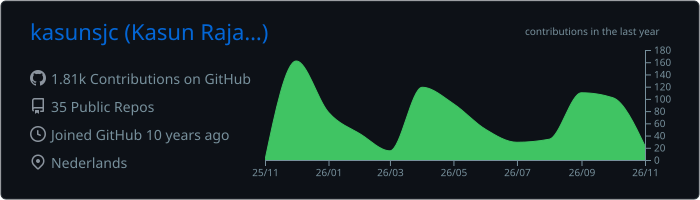
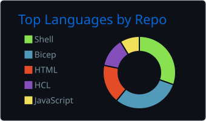
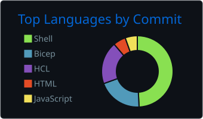
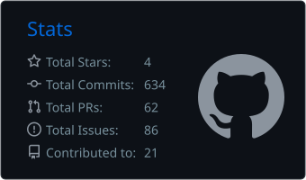
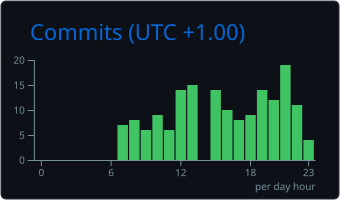

<h1 align="center">Hi there 👋, I'm Kasun Rajapakse</h1>

  
  
  
  

---

### 🧑‍💻 About Me

🔭 I'm a **Cloud & DevOps Engineer** with **8+ years** of experience in Cloud and Windows technologies.

🇱🇰 Originally from **Sri Lanka**, currently living in the **Netherlands** 🇳🇱

🏆 Proud **Microsoft Azure MVP** — [View Profile](https://bit.ly/3gHzNlA)

📝 I write technical articles on [**Blog**](https://kasunrajapakse.me)

💬 Ask me about: **Azure, AWS, Docker 🐳, Kubernetes, Terraform, DevOps** and more!

📫 Reach me at: **kasunsjc@hotmail.com**

---

### 🛠️ Tech Stack & Tools

  
  
  
  
  
  
  
  
  
  
  
  
  

---

### 📈 Contribution Graph

  <picture>
    <source media="(prefers-color-scheme: dark)" srcset="https://raw.githubusercontent.com/kasunsjc/kasunsjc/output/github-contribution-grid-snake-dark.svg" />
    
  </picture>

---

### 📊 GitHub Stats

  

  
  

  
  

  

---

  

